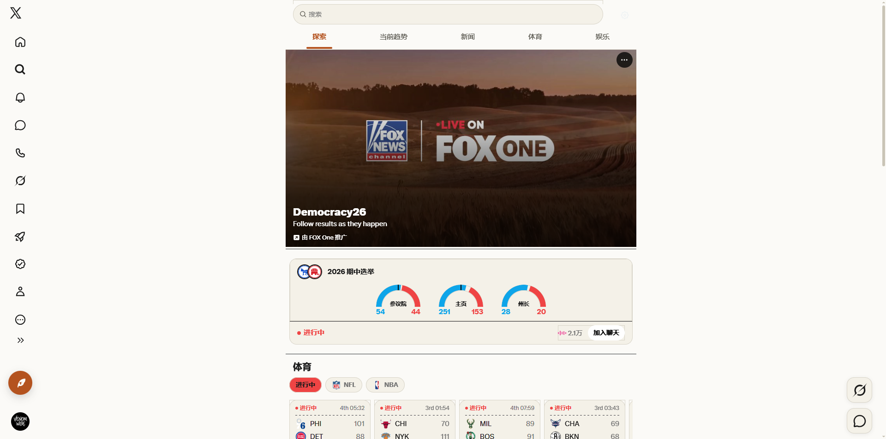
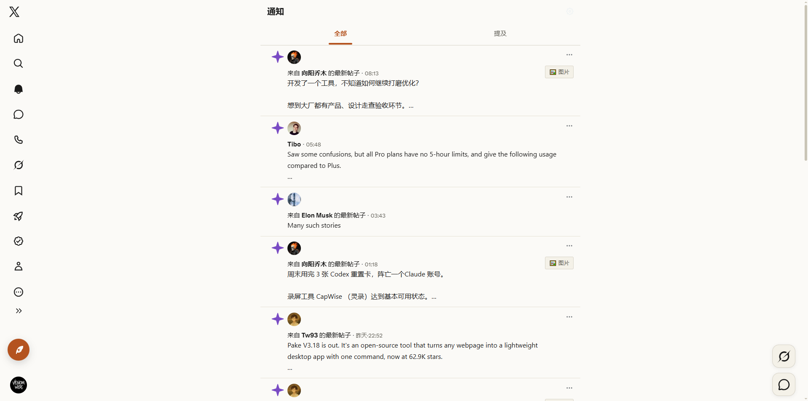
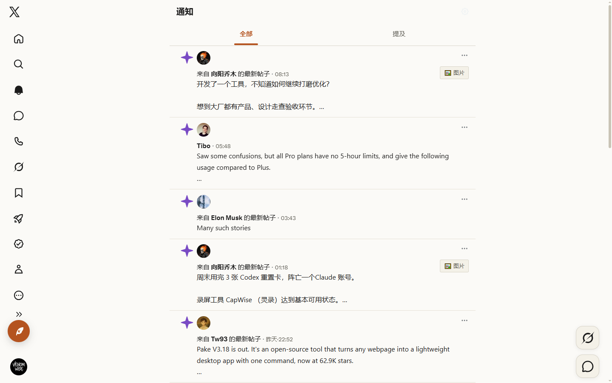
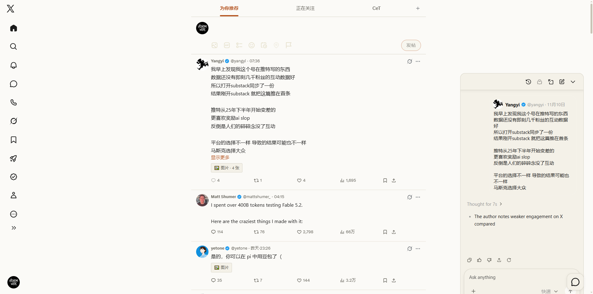
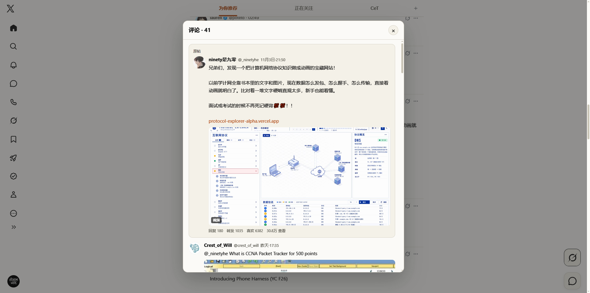
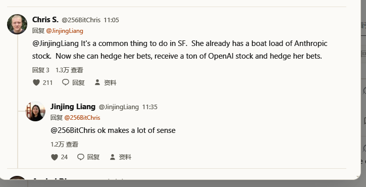
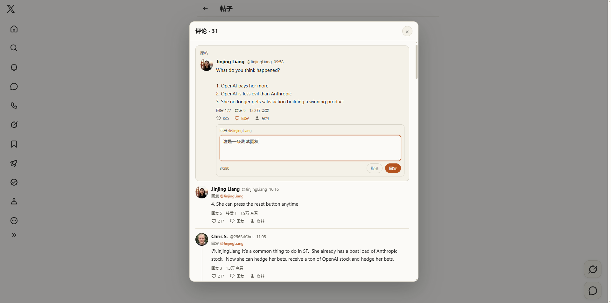
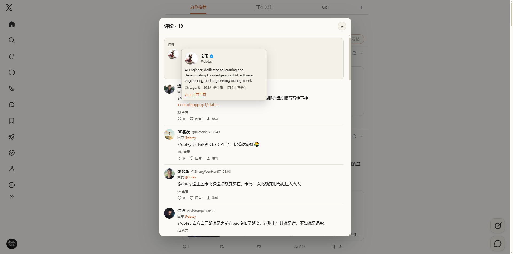

# x-paper

把 X（Twitter）改成安静纸面版面的 Tampermonkey userscript：88px 图标轨、无右栏、居中宽正文、
轻量操作栏、媒体折叠为 emoji 入口、悬停预览原图，发帖时间显示为具体时刻。帖子详情页、文章页、
通知页、探索/搜索、评论弹窗和 Grok 抽屉复用同一套纸面主题。


## 最近更新

- **0.8.1**：从帖子右上角 Grok 图标打开的总结面板也完整纸面化。改观察 `#layers` 下稳定的抽屉层
  （X 会替换 `GrokDrawer` 根节点及两层包装），不再依赖本地化的入口 `aria-label`；开合瞬间抽屉短暂
  缺席时沿用已挂的观察层，避免面板停在深色；引用帖卡片里不带 `dir` 的作者名（纯 `div`）翻成墨色。
- **0.8.0**：通知页改用与首页一致的宽版面（88px 轨道、680/720/760px 居中正文列、隐藏右栏、
  发帖入口收成 FAB）；行内缩略图折叠为「🖼️ 图片」，推广内容隐藏，时间显示具体时刻；
  SPA 切路由后按新的 `primaryColumn` 重新体检，内层时间线不再停在 600px。
- **0.7.9**：脚本生成的界面文案（左轨按钮、媒体按钮、原图预览、评论弹窗、资料卡、错误提示）
  和时间/计数格式跟随 X 的界面语言：中文界面保持原样，其他语言使用英文。
- **0.7.8**：移除「开启/关闭 x-paper」和「帖子/用户主页打开方式」两个菜单开关；脚本默认启用，
  帖子/用户主页始终在新标签页打开，原生资料卡里的头像/用户名也走新标签页。
- **0.7.7**：返回首页的恢复改为一次性对齐，只认 home 的 tab 栏，避免 profile/探索/搜索的
  tablist 被误判；新标签页设置同时覆盖 tweet 头部的头像/用户名链接。
- **0.7.6**：评论回复增加 `x-client-transaction-id` 生成，修复 X 网页 GraphQL 写入返回的
  误导性 344；首次回复会读取 X 的 `/i/jf/` app shell 和 `ondemand.s` 静态脚本。
- **0.7.5**：返回首页更顺滑：滚动条拖动/滚轮/触摸/按键会立即接管，锚点校正窗口缩短，
  并保留媒体展开态；Tampermonkey 菜单可切换帖子在新标签页打开（默认当前标签页）。
- **0.7.4**：评论弹窗内直接回复（纸面输入框、280 字、`Ctrl/Cmd+Enter`）、连线只连接上下
  两个头像且最后一条不再向下延伸、未点赞空心/点赞后暖橙实心。
- **0.7.3**：评论点赞/取消、评论者资料卡、嵌套楼层与过滤非评论内容。
- **0.7.2**：评论弹窗与 Grok 抽屉纸面化。
- **0.7.1**：探索/搜索改用与首页一致的宽版面。

## 功能

- **版面**：视口 ≥1000px 时左轨收窄到 88px、隐藏右栏、正文列按窗口宽度取 680/720/760px 居中，
  首页、帖子详情、个人主页、通知、探索/搜索和「推荐关注」整页（`/i/connect_people`）共用同一套版面；
  小于 1000px 只应用浅色主题，保留 X 原生布局和媒体行为。首次进入或刷新首页时，tab 栏和发帖框
  直接用纸色绘制，不会先闪一帧深色。
- **个人主页**：横幅、头像随正文列缩放；关注按钮用暖橙实心、正在关注用纸面浮起 + 细线，
  操作行里的私信、通知铃铛、更多等按钮（含后续新增的）统一为纸面浮起 + 细线 + 墨色图标，
  悬停使用暖橙描边；时间显示为具体时刻。
- **探索/搜索**：与首页共用 88px 轨道、居中宽正文列和隐藏右栏；搜索框、标签下划线、
  选举/体育聚合卡和底部「显示更多」条都换成纸面样式，卡片内为深底写的白字翻成墨色，
  党派色、比分绿勾等品牌色保留原样。左轨保留发帖入口，收成 52px 圆形暖橙按钮。
- **通知**：与首页共用 88px 轨道、居中宽正文列和隐藏右栏，标签栏用纸面样式；每条通知的
  行内缩略图折叠为「🖼️ 图片」（悬停按钮预览原图），时间显示为具体时刻，推广内容隐藏，左轨
  发帖入口收成 52px 圆形暖橙按钮。点通知行内的头像在新标签页打开主页；通知行本身没有 status
  链接，点正文仍由 X 在当前标签打开帖子。
- **评论弹窗**：在首页、个人主页、通知、探索/搜索页点评论按钮，会在页面内打开纸面评论弹窗，
  显示原帖和首屏评论；首页不会被卸载或重新渲染，关闭后滚动位置保持不变。点帖子正文/时间
  仍然进入原来的状态页。
- **评论互动**：点赞/取消点赞（未点赞空心、点赞后暖橙实心）；悬停头像或用户名查看与主页一致
  的资料卡，悬停资料卡片里的头像可预览大头像；按回复关系缩进的楼层（头像竖线只连接上下两个
  头像，末端圆角转弯 + `|_` 短横线，
  楼层之间才画分割线）；在弹窗内直接回复（纸面输入框、280 字、`Ctrl/Cmd+Enter` 提交，
  不打开独立 composer 窗口），提交后刷新首屏评论并保留滚动位置，`Esc` 只收起输入框；
  过滤掉对话里混入的推荐/广告帖。回复请求会先在本地生成 `x-client-transaction-id`
  （首次需要读取 X 的公开 app shell 和 `ondemand.s` 静态脚本），再提交 `CreateTweet`。
- **帖子/用户主页在新标签页打开**：默认启用，无需设置。点首页/个人主页/探索/搜索里的主帖
  正文、时间戳、tweet 头部头像/用户名，通知行内的头像，或悬停资料卡里的头像/用户名，都会在
  新标签打开，首页不卸载；引用帖、正文内的 @ 链接、媒体和操作按钮仍按 X 原行为处理。
- **Grok**：右下角的 Grok 抽屉和从帖子右上角 Grok 图标打开的总结面板都换成纸面面板、纸面输入卡
  和墨色图标；引用帖卡片的作者名翻成墨色，用户消息的彩色气泡保留原色，不与主题冲突。
- **左轨**：悬停不再自动展开；点击「更多」下方的双箭头展开为 240px，再次点击或按 `Esc` 收起。
  底部账号入口只保留当前账号头像，账号菜单完整弹出。
- **媒体折叠**：首页、个人主页和通知页顶层帖子的图片/视频默认折叠为 `🖼️`/`🎬` 按钮，点击就地展开；
  多图保持原生网格，视频只计一项；引用帖内的媒体同样折叠，并与卡片正文对齐。通知行的
  64px 缩略图没有 `tweetPhoto` 标记，按运行时标记折叠为「🖼️ 图片」。
- **原图预览**：把鼠标停到折叠按钮上约 0.2 秒即可预览该帖的图片原图；视频显示**封面静帧**
  （不播放），多图/多视频并排展示并标注「N 张 · 原图」「视频封面」或「N 项 · 原图/封面」。
  已展开的图片也可以逐张悬停预览。通知行的缩略图同样可以在折叠按钮或展开后的缩略图上悬停
  预览原图。资料卡片（X 悬浮资料卡和评论弹窗资料卡）里的头像悬停后弹出放大的圆形头像；
  时间线、通知和评论列表的头像悬停仍只弹资料卡。
- **详情页/文章页**：顶部条、回复框、内嵌引用帖、代码块和升级横幅都换成纸面样式，阅读进度条使用
  暖橙；线程连接竖线使用浅纸色；进入页面时不会先闪一帧黑色。
- **阅读位置**：从详情页返回首页时一次性对齐离开前的位置，不会持续追着 X 的虚拟列表重排滚动；
  一旦拖动滚动条、滚轮、触摸或按键，自动对齐立即停止；之前展开的媒体保持展开，不会被重新折叠。
- **时间**：按本地时间显示，当天 `HH:mm`；中文界面昨天 `昨天·HH:mm`，更早 `M月D日·HH:mm`
  （跨年带年份）；英文界面 `Yesterday·HH:mm`、`Nov 2·HH:mm`（跨年 `Nov 2, 2025·HH:mm`）。
- **语言**：脚本生成的界面文案（左轨展开按钮、媒体按钮、原图预览、评论弹窗、资料卡、错误提示）
  跟随 X 当前的界面语言（`html[lang]`）：中文界面显示中文，其他语言显示英文；X 自身的界面仍由
  X 本地化。脚本不保存语言设置。
- **降噪**：首页、详情页和通知页隐藏推广帖，首页另隐藏推荐关注和右栏；通知页的推荐关注和
  趋势列表保持可见；探索/搜索页沿用宽版面并隐藏右栏（搜索页的「搜索过滤」卡因此不再显示），
  `<1000px` 时回到 X 原生布局。
- **细节**：操作栏图标 16px、首页点赞暖红、转发/书签暖橙、评论弹窗点赞暖橙；帖子之间用浅纸色
  分隔线，头像和正文列不显示框线；新帖提示和 Toast 使用纸面浮起样式。
- **弹窗与推广卡**：X 原生弹窗（回复框、图片查看器、更多菜单等）保持原生配色；评论弹窗使用
  纸面样式。Premium 订阅页和认证申请页整页不套主题。鼠标悬停用户头像弹出的资料卡换成纸面
  浮起 + 细线，卡内链接使用暖橙。「你尚未通过认证」推广卡保留自己的深色底，卡内文字和关闭
  图标为纯白；悬停资料卡保留 X 自己的认证徽章颜色（蓝色或金色），评论弹窗的资料卡使用 X 的
  蓝色认证徽章图形。

## 界面

首页见上方。

### 探索与搜索

| 探索 | 搜索 |
|---|---|
|  |  |

### 通知

| 1920 | 1440 |
|---|---|
|  |  |

### Grok 抽屉



### 评论弹窗



### 嵌套回复与连线



### 弹窗内回复



### 评论者资料卡



### 点赞状态

未点赞为空心，点赞后为暖橙实心：


## 安装

1. 安装 [Tampermonkey](https://www.tampermonkey.net/)。
2. 从 [Greasy Fork](https://greasyfork.org/scripts/603745-x-paper) 安装；或新建用户脚本，
   粘贴 `x-morning-paper.user.js` 的内容并保存。
3. 打开 <https://x.com/home>。脚本默认启用，没有额外开关；如需停用，在 Tampermonkey 里
   禁用或删除该脚本。

在 Chrome + Tampermonkey 下开发和验证。脚本只申请 `GM_addStyle`。网络请求只有评论弹窗的
`TweetDetail` 读取、用户主动点击「喜欢」时的 `FavoriteTweet`/`UnfavoriteTweet`、用户主动
提交回复时的 `CreateTweet`，以及首次回复时读取 X 的公开 `/i/jf/` app shell 和
`abs.twimg.com` 上的 `ondemand.s` 静态脚本（用于生成 `x-client-transaction-id`；`/i/jf/`
请求不带账号 cookie）。CreateTweet 使用当前浏览器会话和 X Web 的公开 bearer，不发布其他
内容，不关注、不私信或修改其他账号状态。

## 开发

```bash
node --check x-morning-paper.user.js   # 语法检查
python -m http.server 8765             # 然后打开 http://127.0.0.1:8765/test/fixture.html
```

`test/fixture.html` 是带 `GM_*` mock 的 X DOM 切片，默认切到 `/home`，可验证布局、媒体、路由和
降级；`?route=notifications` 切到通知页 mock（含可折叠的通知缩略图），`?theme=light` 模拟 X
浅色设置，`?lang=en` 模拟英文界面。fixture 不能替代真实 X 检查。

真实 X 的取证方式、验证矩阵、选择器锚点和已踩过的坑记录在 `AGENTS.md` 与 `docs/selectors.md`，
改动行为后同步更新两者和 `screenshots/`。更新脚本后在 Tampermonkey 编辑器里覆盖旧内容，
刷新 `x.com/home` 即可生效。

## 项目结构

| 路径 | 用途 |
|---|---|
| `x-morning-paper.user.js` | userscript 本体 |
| `AGENTS.md` | 维护者/agent 的迭代约束、验证循环与已踩过的坑 |
| `docs/selectors.md` | 选择器、状态属性与降级参考 |
| `test/fixture.html` | 本地 mock 页面和 `GM_*` mock |
| `screenshots/` | fixture 与真实 X 的截图 |
| `THIRD_PARTY_NOTICES.md` | 第三方代码许可与版权声明 |
| `LICENSE` | MIT 许可证 |

## 许可

[MIT](LICENSE) © venom. 第三方代码许可见 [THIRD_PARTY_NOTICES.md](THIRD_PARTY_NOTICES.md)。

## 已知限制

- X 的 DOM 和 `data-testid` 会变化；选择器失效时脚本降级为主题模式，不保证覆盖所有实验性布局
  和媒体类型。
- 注入的界面文案只提供中文和英文；其他语言的 X 界面回退到英文，脚本不提供手动语言开关。
- 主题覆盖阅读路径和常见表面；弹窗按底色分深浅处理（深色弹窗保留 X 外观、文字转浅色），
  临时菜单保持原生样式。
- 主要在 X 深色设置和 1920/1440 宽度下验证；浅色设置与 999/1000px 边界仍需手动检查。
- 探索/搜索的聚合卡和侧栏卡依赖运行时按计算样式标记；X 新增深色模块变体时可能需要补充规则。
- 探索/搜索在宽版面下隐藏右栏，搜索页的「搜索过滤」卡随之不可见；通知页在宽版面下隐藏的
  侧栏是趋势/推荐关注列表。搜索结果中的图片/视频保持原生展开。
- 通知行是 `article[data-testid="notification"]`，行内没有 status 链接：点正文/整行仍由 X
  在当前标签打开帖子（脚本无法从 DOM 得到帖子地址），只有行内头像链接会开新标签页；评论
  弹窗需要通知行内嵌带操作栏的 tweet，当前“最新帖子”类通知不显示操作栏。
- 通知行的缩略图是 64px 的内联背景图，不是 `tweetPhoto`，折叠和预览由运行时标记驱动；
  原图同样通过 `pbs.twimg.com` 的 `name=orig` 变体获取。
- 从详情页返回首页时 X 会重建并重新排序虚拟列表；脚本只做一次性对齐，X 的 AbsolutePower
  loader 仍可能自行调用 `scrollBy` 调整位置。要完全避免，点帖子/用户主页时使用新标签页
  （默认行为），或使用评论弹窗。
- 新标签页行为覆盖首页/个人主页/探索/搜索里的主帖正文、时间戳、tweet 头部头像/用户名、
  通知行内的头像，以及原生资料卡里的头像/用户名；引用帖、列表、外部链接等入口仍按 X
  原行为处理，位置恢复逻辑继续作为兜底。
- 评论弹窗依赖 X 的私有 `TweetDetail`、`FavoriteTweet`/`UnfavoriteTweet` 和 `CreateTweet`
  接口；接口或 `features`/`queryId` 改版后可能失效。评论读取失败时弹窗提供「重试」和
  「在新标签页打开帖子」，回复失败时在输入框下方显示错误。只显示首屏评论；回复只支持
  纯文字（280 字），不支持图片、视频或投票。
- 回复依赖 X 的 `x-client-transaction-id` 算法（从 `/i/jf/` 和 `ondemand.s` 推导）。X 改版
  后生成器可能失效，弹窗会显示「生成 X 写入校验头失败」；如果生成的头被 X 拒绝，仍可能出现
  344，需要更新生成器或改用 X 原生 composer。
