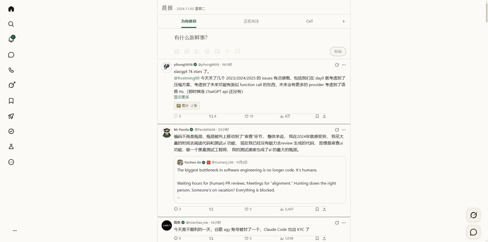

# x-paper

把 X（Twitter）改成安静纸面版面的 Tampermonkey userscript：88px 图标轨、无右栏、居中宽正文、
轻量操作栏、媒体折叠为 emoji 入口、悬停预览原图，发帖时间显示为具体时刻。帖子详情页和文章页
复用同一套纸面主题。



## 功能

- **版面**：视口 ≥1000px 时左轨收窄到 88px、隐藏右栏、正文列按窗口宽度取 680/720/760px 居中，
  首页、帖子详情、个人主页和「推荐关注」整页（`/i/connect_people`）共用同一套版面；小于 1000px
  只应用浅色主题，保留 X 原生布局和媒体行为。
- **个人主页**：横幅、头像随正文列缩放；关注按钮用松绿实心、正在关注用纸面浮起 + 细线，
  私信和更多按钮同样纸面化；时间显示为具体时刻。个人主页的图片/视频保持 X 原生展示。
- **左轨**：悬停不再自动展开；点击「更多」下方的双箭头展开为 240px，再次点击或按 `Esc` 收起。
  底部账号入口只保留当前账号头像，账号菜单完整弹出。
- **媒体折叠**：首页和个人主页顶层帖子的图片/视频默认折叠为 `🖼️`/`🎬` 按钮，点击就地展开；多图保持原生网格，
  视频只计一项；引用帖内的媒体同样折叠，并与卡片正文对齐。
- **原图预览**：把鼠标停到折叠按钮上约 0.2 秒即可预览该帖的图片原图；视频显示**封面静帧**
  （不播放），多图/多视频并排展示并标注「N 张 · 原图」「视频封面」或「N 项 · 原图/封面」。
  已展开的图片也可以逐张悬停预览。
- **详情页/文章页**：顶部条、回复框、内嵌引用帖、代码块和升级横幅都换成纸面样式，阅读进度条使用
  松绿；线程连接竖线使用浅纸色；进入页面时不会先闪一帧黑色。
- **阅读位置**：从详情页返回首页时回到离开前的位置。
- **时间**：按本地时间显示，当天 `HH:mm`，昨天 `昨天·HH:mm`，更早 `M月D日·HH:mm`（跨年带年份）。
- **降噪**：首页和详情页隐藏推广帖，首页另隐藏推荐关注和右栏；搜索、通知等页面只做主题换肤。
- **细节**：操作栏图标 16px、点赞暖红、转发/书签松绿；帖子之间用浅纸色分隔线，头像和正文列
  不显示框线；新帖提示和 Toast 使用纸面浮起样式。
- **弹窗**：Premium、认证、回复框、图片查看器等弹窗保持 X 的深色外观，文字恢复为浅色，
  不会出现纸面墨色落在深色底上的黑底黑字。

## 安装

1. 安装 [Tampermonkey](https://www.tampermonkey.net/)。
2. 新建用户脚本，粘贴 `x-morning-paper.user.js` 的内容并保存。
3. 打开 <https://x.com/home>。Tampermonkey 菜单提供「关闭 x-paper」和「开启 x-paper」。

在 Chrome + Tampermonkey 下开发和验证。脚本只申请 `GM_getValue`、`GM_setValue`、
`GM_registerMenuCommand`、`GM_addStyle`；不发起网络请求，不读取账号数据，开关状态保存在本机。

## 开发

```bash
node --check x-morning-paper.user.js   # 语法检查
python -m http.server 8765             # 然后打开 http://127.0.0.1:8765/test/fixture.html
```

`test/fixture.html` 是带 `GM_*` mock 的 X DOM 切片，默认切到 `/home`，可验证布局、媒体、路由和
降级；`?theme=light` 模拟 X 浅色设置。fixture 不能替代真实 X 检查。

真实 X 的取证方式、验证矩阵、选择器锚点和已踩过的坑记录在 `AGENTS.md` 与 `docs/selectors.md`，
改动行为后同步更新两者和 `screenshots/`。更新脚本后在 Tampermonkey 编辑器里覆盖旧内容，
刷新 `x.com/home` 即可生效。

## 项目结构

| 路径 | 用途 |
|---|---|
| `x-morning-paper.user.js` | userscript 本体 |
| `AGENTS.md` | 维护者/agent 的迭代约束、验证循环与已踩过的坑 |
| `docs/selectors.md` | 选择器、状态属性与降级参考 |
| `test/fixture.html` | 本地 mock 页面和 `GM_*` mock |
| `screenshots/` | fixture 与真实 X 的截图 |
| `LICENSE` | MIT 许可证 |

## 许可

[MIT](LICENSE) © venom

## 已知限制

- X 的 DOM 和 `data-testid` 会变化；选择器失效时脚本降级为主题模式，不保证覆盖所有实验性布局
  和媒体类型。
- 主题覆盖阅读路径和常见表面；X 的临时菜单、弹窗和对话框保持原生样式。
- 主要在 X 深色设置和 1920/1440 宽度下验证；浅色设置与 999/1000px 边界仍需手动检查。
